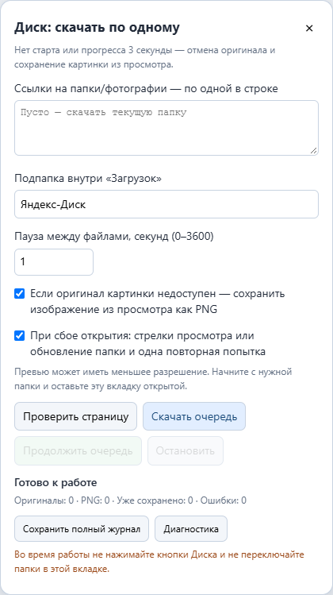

# Дополнение для Firefox — скачивание фотографий и фотоархивов с Яндекс Диска

Дополнение для браузера Mozilla Firefox помогает скачивать фотографии и фотоархивы
из публичных папок Яндекс Диска: открывает фотографии по одной, нажимает «Скачать»
и автоматически заходит во вложенные папки. Пауза между файлами выбирается
в панели (по умолчанию 1 секунда). Можно обработать очередь из нескольких ссылок.

Фотоархивы в виде папок скачиваются с сохранением структуры вложенных папок.
Готовые архивы ZIP/RAR/7Z скачиваются как отдельные файлы, без распаковки.

Если оригинал не начинает скачиваться за 3 секунды или столько же времени
не поступают новые байты, расширение отменяет оригинал. Для изображений оно
затем сохраняет картинку из окна просмотра как PNG и переходит к следующему файлу.



## Возможности

- Обход вложенных папок через действия на странице.
- Очередь публичных ссылок: по одной ссылке на строку, без параллельных загрузок.
- Пауза от 0 до 3600 секунд, в том числе дробная.
- Сохранение структуры папок внутри обычной папки загрузок Firefox.
- Поддержка публичных страниц `disk.yandex.ru/d/…` и общего доступа
  `disk.360.yandex.ru/client/aa/d_…`.
- Отмена зависшей загрузки после 3 секунд без поступления байтов.
- Сохранение PNG из просмотра, когда оригинал изображения недоступен.
- Остановка очереди и продолжение с пропуском ранее сохранённых файлов.
- Полный журнал в локальном хранилище, экспорт всех записей в TXT.
- Восстановление сбоя открытия через стрелки просмотра либо обновление страницы.
- Локальный отчёт о разметке страницы для диагностики.

## Установка

Сборка не подписана Mozilla и устанавливается как **временное дополнение**.
После перезапуска Firefox её нужно загрузить снова. Публикация на GitHub
не заменяет подписывание Mozilla для постоянной установки.

1. Скачайте ZIP/XPI из Releases или получите исходники и выполните сборку ниже.
2. В Firefox откройте `about:debugging#/runtime/this-firefox`.
3. Нажмите «Загрузить временное дополнение…» и выберите XPI либо `extension/manifest.json`.
4. Откройте нужную публичную папку Диска и обновите страницу.
5. Панель появится справа внизу. Нажмите «Проверить страницу», затем «Скачать очередь».

Через кнопку расширения можно ввести одну или несколько публичных ссылок и открыть первую с панелью.
В проекте нет встроенного адреса чужого архива.

## Использование

Вставьте ссылки в поле панели **по одной в строке**. Если поле пустое, очередь
состоит из текущей открытой папки. При нескольких ссылках каждой выделяется
отдельная стабильная подпапка, чтобы одноимённые фотографии из разных архивов не смешивались.
Повторяющиеся ссылки на ту же папку исключаются. Некорректная строка блокирует запуск
с указанием её номера, а не пропускается молча.

Поле «Пауза» задаёт дополнительное ожидание между файлами и перед попыткой PNG.
Тайм-аут отсутствия старта/прогресса остаётся равным 3 секундам независимо от паузы.

Поле «Подпапка внутри Загрузок» задаёт относительный путь, например `Фото/Коллекция`.
Папку загрузок целиком задают в настройках Firefox.
Оставьте галочку сохранения PNG включённой, чтобы получать изображение из просмотра
при недоступном или зависшем оригинале. Превью может быть меньше оригинала.

Во время работы оставьте вкладку Диска открытой и не меняйте в ней папки вручную.
Кнопка «Остановить» отменяет управляемую загрузку. **«Продолжить очередь»** загружает
сохранённые ссылки и настройки и сама возвращается к исходным папкам. Очередь
повторно обходит ссылки с начала, но пропускает подтверждённые оригиналы и PNG.
После обновления страницы/перезапуска фоновой части продолжение запускается вручную,
без неожиданного автоматического скачивания.

Перед пропуском проверяется запись расширения, успешное завершение в истории Firefox,
точное имя сохранённого файла и признак его наличия. При смене идентификатора загрузки
ищется точное сохранённое имя. Удалённый файл скачивается повторно. Учитываются записи
предыдущей версии 1.1.1 при сохранении прежней папки загрузки.

Дополнение не сканирует произвольную папку компьютера и не может достоверно распознать
старые файлы, если записи расширения или история Firefox удалены. Временная установка
не гарантирует сохранение данных после удаления/повторной установки дополнения.

В панели отображаются последние 150 строк, но **«Сохранить полный журнал»** выгружает
все записи текущей очереди, включая предыдущие продолжения. Полный журнал пишется
локально по блокам, без ограничения в 500 строк. Новая очередь создаёт новый журнал;
перед её запуском сохраните журнал предыдущей. При ошибке записи хранилища очередь
останавливается, а не продолжает работу с незаписанным прогрессом.

Если не подтверждено открытие файла, дополнение пробует переоткрыть именно эту
фотографию стрелками, проверяя имя до и после. Если это невозможно, обновляет папку
и делает одну повторную попытку открытия. Неудача записывается в журнал; при безопасном
возврате к папке очередь идёт дальше. CAPTCHA, уход вкладки на другой сайт и
неподтверждённая отмена загрузки не обходятся — очередь останавливается.

Если не удалось сохранить ни оригинал, ни картинку, ошибка записывается в журнал,
после чего очередь идёт дальше. Файлы других типов нельзя заменить изображением.

## Разработка и сборка

Нужен Node.js 22 или новее. Сборка и основные тесты используют встроенные модули:

```sh
npm test
npm run build
```

В `dist/` появятся ZIP и XPI. `manifest.json` находится в корне обоих пакетов.

Дополнительные проверки настоящих DOM-действий на синтетической странице:

```sh
npm install
npx playwright install chromium
npm run test:browser
```

Тесты запускают Chromium для проверки DOM и моделируют Firefox API.
Это не проверка установки расширения и реального скачивания в Firefox.
На рабочей машине можно указать установленный Chromium через `YD_BROWSER_EXECUTABLE`.

GitHub Actions запускает основные проверки и собирает пакеты при push/PR.
Тег `v1.2.0` запускает workflow Release и публикует ZIP/XPI. Версия тега должна
совпадать с `extension/manifest.json` и `package.json`.

## Ограничения

- Интерфейс Яндекса может измениться; адаптер DOM находится в `extension/site.js`.
- Реальная текущая разметка Яндекса не проверена в среде разработки: доступ к сайту отсутствовал.
- Локально выполнены проверки очереди и реальных DOM-действий на тестовом макете,
  включая сохранение PNG после тайм-аутов старта и прогресса оригинала.
- Поддерживаются публичные ссылки и их интерфейс общего доступа; личный `/client/disk` не обрабатывается.
- Превью теряет анимацию и метаданные; оригинал проверяется менеджером загрузок Firefox.
- ZIP/RAR/7Z скачиваются целиком, без распаковки. Пустые папки локально не создаются.
- Продолжение опирается на историю загрузок. Изменение файла под прежним именем не обнаруживается.
- Пароли, CAPTCHA и ограничения владельца не обходятся.
- Если Firefox не подтверждает отмену активной загрузки, очередь останавливается.

## Данные и доступ

Ссылки, настройки и результаты хранятся локально в Firefox. Телеметрии нет.
Диагностика сохраняется только по нажатию кнопки и никуда автоматически не отправляется.
Разрешения доменов Яндекса нужны для работы на странице, перехвата ссылок скачивания
и получения картинки из просмотра. Подробнее: [PRIVACY.md](PRIVACY.md).

Лицензия на повторное использование пока не выбрана (`UNLICENSED`).
